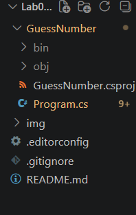

# Лабораторная работа №5. Условные конструкции в C#

## Основная информация

ФИО: Шевченко Вероника Никитична
Группа: ИСП-242
Дата: 13.10.26

## Краткое описание работы
Условные конструкции языка C#: оператор if/else и else if для общего ветвления и проверки нескольких взаимоисключающих условий, вложенные условия и логические операторы &&, || и !, тернарный оператор ? : как сокращённая форма записи if/else для выбора одного из двух значений, а также оператор switch/case с группировкой case и веткой default

## Структура проекта


## Блок кода
```csharp
// код
string GetHint(int diff)
{
    switch (diff)
    {
        case <= 5:
            return "🔥 Горячо!";
        case <= 15:
            return "♨️ Тепло.";
        case <= 30:
            return "❄️ Холодно.";
        default:
            return "🧊 Очень холодно!";
    }
}
```

## Выводы
1. if/else — базовая и самая гибкая конструкция ветвления, подходит для любых условий, включая составные выражения с &&, || и !
2. switch/case удобен для сравнения одной переменной с конкретными значениями и делает код нагляднее длинной цепочки if/else if
3. Тернарный оператор повышает краткость, но применять его стоит только для простых случаев "одно из двух", иначе страдает читаемость

## Таблица
|конструкция|когда использовать|
|-----------|------------------|
|if/else|Общее ветвление, сложные условия|
|else if|Несколько взаимоисключающих вариантов|
|switch/case|Сравнение одной переменной с конкретными значениями|
|Тернарный оператор ? :|Выбор одного из двух значений в одну строку|
|&&|Оба условия должны быть истинны|
||||Хотя бы одно условие должно быть истинно|
|!|Отрицание условия|
|int.TryParse()|Безопасное преобразование строки в число|
|Random.Next(min, max)|Генерация случайного числа в диапазоне|

## Ответы 
1. int.Parse() выбрасывает исключение при некорректной строке, а int.TryParse() возвращает false и не прерывает программу. Первый уместен для гарантированно корректных данных, второй — для ввода от пользователя
2. Когда одна переменная сравнивается с конкретными значениями, а не с диапазонами. Пример: обработка пункта меню (1–4) — код плоский, наглядный и легко расширяется
3. Возникнет ошибка компиляции CS0163, так как C# запрещает неявный переход к следующему case с кодом. Исключение — группировка пустых case, когда несколько значений выполняют один блок
4. = — присваивание, == — сравнение. Это частая ошибка, потому что в математике = означает равенство; в C# сравнение требует двух знаков
5. Да, но читаемость падает